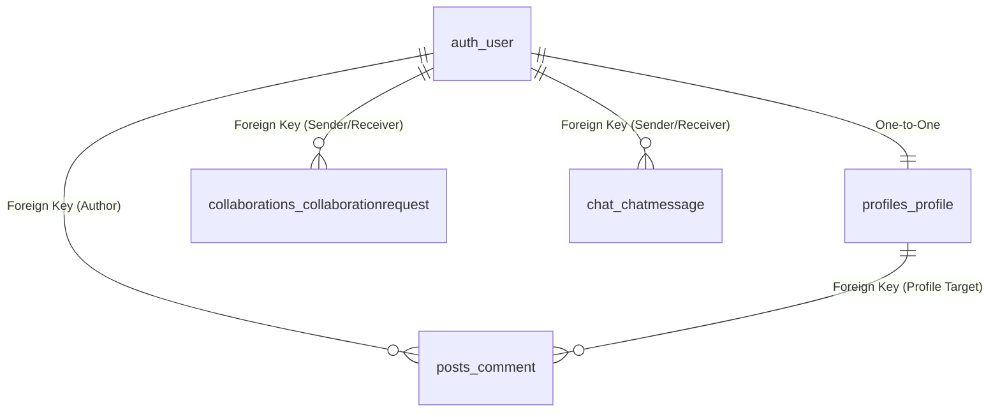

# The Common Room — Technical Architecture & Data Flow Guide

---

## 1. Technologies Used & Their Exact Roles

### Frontend (User Interface Layer)
- **Next.js 15 (App Router)**: Acts as the React-based framework for page routing (`/dashboard`, `/students`, `/chat`), component rendering, and client-side page transitions.
- **TypeScript**: Enforces strict static typing across components, API payload interfaces, and state objects, preventing runtime JavaScript bugs.
- **Tailwind CSS v4**: Utility-first CSS framework used for layout grid systems, dark/light mode color tokens, glassmorphic navigation bars, and responsive styling.
- **Lucide React (`lucide-react`)**: Provides clean, vector-based UI icons (`GraduationCap`, `BookOpen`, `Building`, `CheckCircle2`, `Clock`, `Send`, `Eye`, `EyeOff`).

### Backend (Application & API Layer)
- **Django 6**: High-level Python web framework providing URL routing, security middleware, authentication mechanisms, and business logic.
- **Django REST Framework (DRF)**: Converts Django backend models and Python data structures into standardized RESTful JSON API endpoints.
- **SimpleJWT (`rest_framework_simplejwt`)**: Handles stateless user authentication using JSON Web Tokens (`access` and `refresh` tokens).
- **CORS Headers (`django-cors-headers`)**: Middleware allowing Cross-Origin Resource Sharing so the Next.js frontend (`localhost:3000`) can securely communicate with the Django backend (`localhost:8000`).

### Database (Data Persistence Layer)
- **PostgreSQL**: Industrial-grade Relational Database Management System (RDBMS) storing application tables (`commonroom_db`).
- **Psycopg2 (`psycopg2-binary`)**: The database adapter driving high-performance TCP/IP socket connections between Django and PostgreSQL.

---

## 2. How Backend and Frontend are Connected

The frontend and backend operate as two decoupled systems communicating over HTTP REST APIs.

```text
[ Next.js Frontend ]  <--- HTTP JSON Requests / Responses --->  [ Django REST API Backend ]
(Port 3000)               (Axios + JWT Bearer Tokens)             (Port 8000)
```

1. **API Endpoints Base URL**: The frontend sends HTTP requests to `http://127.0.0.1:8000/api/`.
2. **Centralized Service Wrapper (`frontend/services/api.ts`)**: An Axios client instance intercepts outbound requests and automatically attaches the user's JWT access token:
   ```http
   Authorization: Bearer <JWT_ACCESS_TOKEN>
   ```
3. **CORS Validation**: When Next.js sends a request to Django, Django's CORS middleware verifies that `http://localhost:3000` is listed in `CORS_ALLOWED_ORIGINS`. If allowed, Django processes the request and responds with a JSON payload.
4. **Stateless JWT Lifecycle**:
   - **Login**: User submits credentials to `/api/accounts/login/`.
   - **Token Generation**: Backend returns `access` (short-lived authentication token) and `refresh` (token used to get a new access token).
   - **Storage**: Frontend stores the `access` token in `localStorage` to persist the session.

---

## 3. How the Backend Stores Information

The backend utilizes Django ORM (Object-Relational Mapping) to translate Python objects into SQL transactions.

```text
Python Class (Model)  --->  Django Serializer  --->  Django ORM  --->  SQL Queries  --->  PostgreSQL Table
```

### Data Processing Pipeline
1. **Validation**: When data arrives at an API endpoint (e.g., updating a profile or sending a message), Django Serializers validate the fields (checking data types, required strings, or complex password criteria).
2. **Password Hashing**: Plain text passwords are never stored. Django uses `ComplexPasswordValidator` to verify strength rules and hashes the password using PBKDF2 with SHA-256 before writing to the `auth_user` table.
3. **Profile Picture Compression**: Base64 image strings created by the client-side HTML5 canvas (300×300 JPEG) are stored directly inside text fields in PostgreSQL, ensuring lightweight and fast database queries.
4. **ORM Translation**: Django calls `serializer.save()`, which issues parameterized SQL commands (`INSERT INTO`, `UPDATE`) to PostgreSQL.

---

## 4. How the Frontend Uses Information from the Backend

The frontend fetches data asynchronously and updates its interactive UI using React hooks:

```text
useEffect Hook  --->  Axios API Call  --->  JSON Received  --->  useState Update  --->  React UI Render
```

1. **Fetching Data (`useEffect`)**: When a page loads (e.g. `/students`), a `useEffect` hook fires an asynchronous function (e.g. `getStudents(token)`).
2. **Updating Local State (`useState`)**: Upon receiving the JSON array from the backend API, the data is saved into React state:
   ```tsx
   const [students, setStudents] = useState<Student[]>([]);
   ```
3. **Dynamic Component Rendering**: React iterates through the array and dynamically renders UI cards:
   ```tsx
   {students.map((student) => (
       <StudentCard key={student.id} student={student} />
   ))}
   ```
4. **Conditional UI Behavior**: The frontend uses returned boolean properties (like `is_already_sent` or `skill_matches.has_match`) to decide whether to show **"Connected"**, **"Request Sent"**, or **"Send Collaboration Request"** buttons.

---

## 5. How the Database is Connected & How It Works

### Connection Mechanism
Django connects to PostgreSQL via configuration settings in `backend/common_room_backend/settings.py`:
```python
DATABASES = {
    'default': {
        'ENGINE': 'django.db.backends.postgresql',
        'NAME': 'commonroom_db',
        'USER': 'postgres',
        'PASSWORD': '*****',
        'HOST': 'localhost',
        'PORT': '5432',
    }
}
```
When the backend starts, `psycopg2` establishes a persistent connection pool to PostgreSQL at `localhost:5432`.

### Relational Database Structure



### How Database Schema Relational Integrity Works
- **Primary Keys (PK)**: Every row in every table is automatically assigned a unique integer `id`.
- **Foreign Keys (FK)**: Tables link to each other using relationships. For example, `Profile` has a `user_id` Foreign Key pointing to `auth_user(id)`.
- **Cascading Deletes (`on_delete=models.CASCADE`)**: If a user is deleted, Django automatically deletes their linked `Profile`, `CollaborationRequests`, and `ChatMessages`, keeping the database clean.
- **Django Migrations (`python manage.py migrate`)**: Whenever Python models change, Django generates SQL DDL migration files that alter PostgreSQL table columns safely without data loss.
