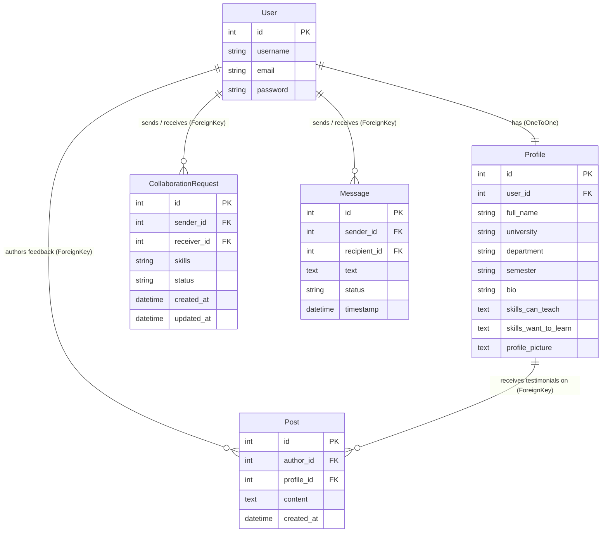

# 🎓 The Common Room — Master Viva, Defense & Presentation Guide

> **Official Comprehensive Technical Defense Companion**  
> *Everything you need to master your viva defense: technology decisions, complete feature catalog, line-by-line function explanations, database ERD, full Banglish presentation script, live modification cheatsheets, and top 30 examiner Q&As.*

---

## 📑 TABLE OF CONTENTS

1. [Section 1: Complete Tech Stack & Architectural Decisions (Why chosen?)](#section-1-complete-tech-stack--architectural-decisions)
2. [Section 2: Complete Platform Features Matrix (All 20 Features)](#section-2-complete-platform-features-matrix)
3. [Section 3: System Architecture, Data Flow & Database ERD](#section-3-system-architecture-data-flow--database-erd)
4. [Section 4: Critical Function Catalog & Line-by-Line Code Explanations](#section-4-critical-function-catalog--code-explanations)
5. [Section 5: Complete Banglish Presentation Script (Step-by-Step Live Demo)](#section-5-complete-banglish-presentation-script)
6. [Section 6: Live Code Modification Cheatsheet (If Sir asks you to change code live)](#section-6-live-code-modification-cheatsheet)
7. [Section 7: Top 30 Most Expected Viva Questions & Model Answers](#section-7-top-30-most-expected-viva-questions--model-answers)

---

# SECTION 1: COMPLETE TECH STACK & ARCHITECTURAL DECISIONS

If the examiner asks: *"What technologies have you used and why did you choose them over alternatives?"*

| Layer | Technology | Why Chosen & Key Advantages | Alternatives Considered |
| :--- | :--- | :--- | :--- |
| **Frontend Framework** | **Next.js 16 (App Router) + React 19** | Built-in file-based routing (`/dashboard`, `/chat`, `/students/[id]`), server & client components, optimal bundle size, fast client navigation with prefetching. | Plain React SPA (Vite), Angular, Vue |
| **Programming Language** | **TypeScript 5.x** | Static type safety, eliminates runtime `undefined`/type errors, provides IDE autocompletion for API models (`User`, `Profile`, `Message`). | Plain JavaScript |
| **Styling & Design System** | **Tailwind CSS v4 + Custom Tokens** | Utility-first styling, zero CSS bloat, instant responsive utility classes (`sm:`, `md:`, `lg:`), native dark mode classes (`dark:`). | Bootstrap (too generic), Material UI |
| **Backend Framework** | **Django 5.x + Django REST Framework (DRF)** | Batteries-included Python framework, built-in ORM with SQL injection protection, native authentication system, robust serializer architecture. | Express.js / Node.js, FastAPI, Flask |
| **Authentication & Tokens** | **djangorestframework-simplejwt (JWT)** | Stateless token-based auth (Access + Refresh tokens). The server does not need to store active sessions in RAM, making it scalable and cloud-friendly. | Session Cookies, OAuth2 |
| **Cloud Database** | **PostgreSQL 16 (Neon Serverless Cloud)** | Industry-standard relational database, ACID-compliant transactions, foreign key integrity, powerful string search & indexing. Hosted in AWS Singapore. | SQLite (used for local fallback), MongoDB |
| **Icons & UI Assets** | **Lucide React** | Featherweight tree-shakeable SVG icon library with consistent 24px stroke design. | FontAwesome |
| **Cloud Deployment** | **Vercel (Frontend) + Netlify (Mirror) + Render (Backend API)** | Zero-config continuous deployment (CI/CD) from GitHub `main` branch with automated build pipelines. | AWS EC2, Heroku, DigitalOcean |
| **24/7 Keepalive** | **UptimeRobot** | HTTP monitor pinging backend every 5 minutes to prevent cloud instance sleep delays. | Cron jobs |

---

# SECTION 2: COMPLETE PLATFORM FEATURES MATRIX

If the examiner asks: *"What features have you built in this platform?"*

1. **Dual Sign-In Authentication**: Log in using either **Username OR University Email**.
2. **5-Rule Strict Password Enforcement**: Minimum 8 characters, uppercase, lowercase, number, and special symbol with live dynamic strength checklist.
3. **Password Recovery & Reset**: Endpoint `/api/accounts/password_reset/` with complex password validation.
4. **Academic Profile Management**: Name, university, department, semester, bio, and student identity metadata.
5. **Interactive Skills Tag / Pill Box**: Modern tag input where pressing `Enter`, `Comma (,)`, `Semicolon (;)`, or `+ Add` creates removable pills with 1-click `✕` deletion.
6. **Multi-Delimiter Smart Regex Parser**: Automatically splits pasted skill lists across `[,;\n\r|•]+` without creating duplicates.
7. **Profile Photo Action Toolbar**: Instant avatar upload, client-side HTML5 canvas compression, and 1-click photo removal with gradient initials fallback.
8. **Bidirectional Automated Skill Matching Engine**: Compares target skills with my skills and computes mutual learning synergies (`can_learn_from_peer` & `can_teach_to_peer`).
9. **Student Peer Directory & Search**: Live keyword search by name, department, university, or skill pills with matching highlights.
10. **Single Student Detailed Profile**: Deep view showing academic tags, reciprocal skill matrix cards, collaboration trigger, and testimonial form.
11. **Formal Collaboration Request Workflow**: Send, accept, decline requests with status badges (`Pending`, `Accepted`, `Declined`).
12. **Resend Collaboration Request Feature**: Allows students to send a fresh request if a previous one was declined in the past.
13. **Accurate User ID vs Profile ID Handshake**: Strict identity verification eliminating ID collision across models.
14. **1-on-1 Real-Time Chat Interface**: Direct messaging between accepted collaborators with instant message delivery and sender/receiver bubble alignment.
15. **Live Chat Unread Counter Badges**: Red pulsing badges display unread message count beside each peer in the chat sidebar.
16. **Local Timezone Timestamp Formatting**: All message times dynamically format to the student's exact device clock (`toLocaleTimeString`).
17. **Smart Scroll Message Tracking**: 3-second background polling never forcibly pulls users down when reading past chat history.
18. **Verified Peer Endorsements / Testimonials**: Read-only permanent feedback posted on peer collaborator profiles.
19. **3-Tab Student Command Dashboard**: Organized tabs for Collaboration Requests (Received & Sent), Peer Endorsements, and My Overview (4 live KPIs).
20. **3-Way Theme Switcher & Full Mobile Drawer**: Light, Dark, and System appearance modes with responsive drawer navigation for phones and tablets.

---

# SECTION 3: SYSTEM ARCHITECTURE, DATA FLOW & DATABASE ERD

### High-Level Architecture Diagram:

```text
┌────────────────────────────────────────────────────────┐
│             Next.js 16 (React 19) Frontend             │
│        (Vercel: thecommonroom-hub.vercel.app)          │
│        (Netlify: thecommonroom-hub.netlify.app)        │
└───────────────────────────┬────────────────────────────┘
                            │
                     HTTP / JSON REST
               Authorization: Bearer <JWT>
                            │
┌───────────────────────────v────────────────────────────┐
│               Django 5 + DRF Backend                   │
│      (Render: thecommonroom-backend.onrender.com)      │
│  - Middleware: CorsMiddleware, WhiteNoiseMiddleware   │
│  - Auth: SimpleJWT Authentication                      │
└───────────────────────────┬────────────────────────────┘
                            │
                       SQL Queries
                  dj-database-url (SSL)
                            │
┌───────────────────────────v────────────────────────────┐
│            Neon PostgreSQL 16 Cloud Database           │
│             (AWS Asia Pacific - Singapore)             │
└────────────────────────────────────────────────────────┘
```

### Entity Relationship Diagram (ERD):



---

# SECTION 4: CRITICAL FUNCTION CATALOG & CODE EXPLANATIONS

If the examiner asks: *"What does this function do? Show me where this logic is implemented."*

### 1. Skill Matching Algorithm (`backend/profiles/serializers.py` -> `get_skill_matches`)
- **File**: `backend/profiles/serializers.py`
- **Purpose**: Calculates whether the logged-in user and a target peer have reciprocal skills to teach and learn from each other.
- **How it works**:
  1. Parses both users' `skills_can_teach` and `skills_want_to_learn` into clean lowercase string sets.
  2. Evaluates `can_learn_from_peer = target_teach ∩ my_learn` (Skills the peer teaches that I want to learn).
  3. Evaluates `can_teach_to_peer = target_learn ∩ my_teach` (Skills I teach that the peer wants to learn).
  4. Returns `has_match = True` if either list has matches.

### 2. Multi-Delimiter Skill Parser (`backend/profiles/serializers.py` -> `parse_skills`)
- **Purpose**: Normalizes skill strings entered with varied punctuation.
- **Code**: `re.split(r'[,;\n\r|•]+', str(skills_str))`
- **Benefit**: If a user enters `Python; Django, React | Next.js`, it extracts `["Python", "Django", "React", "Next.js"]` cleanly without duplicates.

### 3. Dual Sign-In Authentication (`backend/accounts/views.py` -> `CustomTokenObtainPairView`)
- **Purpose**: Allows users to log in using either their username or their email address.
- **How it works**: If the login string contains `@`, it queries `User.objects.filter(email__iexact=username).first()` to retrieve the corresponding username before verifying the password against PBKDF2 hashes.

### 4. Complex Password Validator (`backend/accounts/validators.py` -> `ComplexPasswordValidator`)
- **Purpose**: Enforces 5 enterprise security rules:
  1. Length >= 8 characters.
  2. Uppercase letter (`re.search(r'[A-Z]', password)`).
  3. Lowercase letter (`re.search(r'[a-z]', password)`).
  4. Numeric digit (`re.search(r'\d', password)`).
  5. Special symbol (`re.search(r'[!@#$%^&*(),.?":{}|<>]', password)`).

### 5. Smart Scroll Preservation in Chat (`frontend/app/chat/page.tsx`)
- **Purpose**: Prevents 3-second background polling from interrupting the user when they scroll up to read past chat history.
- **How it works**:
  - `handleScroll` computes `isNearBottom = scrollHeight - scrollTop - clientHeight < 100`.
  - `isNearBottomRef.current` stores this boolean.
  - When new polled messages arrive, `scrollToBottom()` is only triggered if `isNearBottomRef.current === true`.

### 6. Interactive Skill Tag Input (`frontend/app/profile/edit/page.tsx` -> `SkillTagInput`)
- **Purpose**: Replaces standard HTML textarea with an interactive tag/pill creation component.
- **How it works**: Listens for `keydown` on `Enter`, `Comma (,)`, and `Semicolon (;)`. Adds the trimmed token to a Set of unique pills and updates parent form state with `.join(", ")`.

### 7. 3-Way Theme Switcher with OS Listener (`frontend/components/Navbar.tsx` -> `applyTheme`)
- **Purpose**: Manages Light, Dark, and System appearance.
- **How it works**: Queries `window.matchMedia('(prefers-color-scheme: dark)')` to dynamically sync with the student's operating system dark/light mode.

---

# SECTION 5: COMPLETE BANGLISH PRESENTATION SCRIPT

### Phase 1: Intro & Problem Statement (30s)
> *"Assalamu Alaikum Sir. Amader project er naam **The Common Room** — it is a peer-to-peer campus skill sharing and academic collaboration platform.*  
> *University te students ra prayi specific skills (like Python, React, Machine Learning) shikh te chay, kintu department er ba campus er kar kache shei skill ache ta khuje pay na. Facebook ba WhatsApp e collaboration khoja khub unstructured. Tai amra ekta dedicated platform build korechi jekhane students ra skill portfolio banate pare, automated matching er maddhome study buddy khuje pay, request pathiye connect hote pare, ebong direct 1-on-1 chat korte pare."*

### Phase 2: Tech Stack (30s)
> *"Sir, amader architecture full decoupled:*  
> * *Frontend: **Next.js 16 (App Router)** with **React 19**, **TypeScript**, and **Tailwind CSS v4**.*  
> * *Backend: **Django 5** with **Django REST Framework (DRF)**.*  
> * *Auth: Stateless **JWT (SimpleJWT)**.*  
> * *Database: **Neon Serverless PostgreSQL 16 (AWS Singapore)**.*  
> * *Live Deployment: Frontend on **Vercel** (`thecommonroom-hub.vercel.app`) and Backend on **Render**."*

### Phase 3: Registration & Dual Login (1 min)
> *(Show register & password checklist, then login)*  
> *"Registration e amra **5-Rule Dynamic Password Validation** diyechi (8+ length, upper, lower, number, symbol). Login er shomoy student chaile tar **Username** ba **University Email** — je kono ekta diye password input kore login korte parbe."*

### Phase 4: Dashboard & Interactive Skills Tag Box (1 min)
> *(Show Dashboard tabs, then open Edit Profile)*  
> *"Dashboard e student er academic details, Skills I Can Teach, ebong Skills I Want to Learn show kore. Niche 3-Tab command center ache (Requests, Feedback, Overview).*  
> *(Type skill & press Enter/Comma)*  
> *Profile edit e amra interactive **Tag / Pill Input Box** diyechi. Skill likhe Enter ba Comma press korle instant pill create hoy, ebong multi-line list paste korle regex parser auto-split kore dey."*

### Phase 5: Student Directory & Skill Matching (1.5 min)
> *(Show /students, point to Skill Match badge, open detail profile)*  
> *"Browse Students page e search bar ebong skill filter chips ache. Jader shathe reciprocal skill match ache, tader card e instant **⚡ Skill Match** badge show kore.*  
> *Profile detail e gele amader algorithm 2 ta specific set calculate kore: `can_learn_from_peer` ebong `can_teach_to_peer`."*

### Phase 6: Collaboration Lifecycle & 1-on-1 Chat (1.5 min)
> *(Demonstrate sending request, accepted status, then open /chat)*  
> *"Connect click korle request send hoy. Peer student accept korle private 1-on-1 chat unlock hoy.*  
> *Chat window te live unread badges show kore, timestamps automatically student er **device timezone** e convert hoy, ebong smart-scroll lock thakay purono message porar shomoy auto-scroll disturb kore na."*

### Phase 7: Mobile Responsiveness & Conclusion (45s)
> *(Switch Light/Dark/System theme, toggle mobile view, show back arrow in chat)*  
> *"Amader system e 3-Way Appearance Switcher (Light/Dark/System) ache. Mobile e navbar hamburger drawer e convert hoy ebong chat full-screen view te smooth touch scrolling provide kore with a back arrow.*  
> *Thank you Sir! We are ready for your questions."*

---

# SECTION 6: LIVE CODE MODIFICATION CHEATSHEET

If the examiner asks: *"Can you change X in the code right now and show me?"*

### 1. "Change the Chat Polling Interval"
- **File**: `frontend/app/chat/page.tsx`
- **Search for**: `const intervalId = setInterval(fetchMessages, 3000);`
- **Change**: `3000` (3 seconds) to `1000` (1 second) or `5000` (5 seconds).

### 2. "Change Primary Theme Colors"
- **File**: `frontend/components/Navbar.tsx` or `frontend/app/page.tsx`
- **Search for**: `from-indigo-600 to-indigo-800` or `bg-indigo-600`
- **Change to**: Emerald green (`from-emerald-600 to-teal-700` / `bg-emerald-600`) or Rose red (`from-rose-600 to-pink-700` / `bg-rose-600`).

### 3. "Change Minimum Password Length from 8 to 10"
- **File 1 (Backend Validator)**: `backend/accounts/validators.py` -> `if len(password) < 10:`
- **File 2 (Frontend)**: `frontend/utils/passwordValidation.ts` -> `password.length >= 10`

### 4. "Add a New Department in the Dropdown"
- **File**: `frontend/app/profile/edit/page.tsx`
- **Search for**: `<option value="CSE">`
- **Add**: `<option value="AI & Data Science">AI & Data Science</option>`

---

# SECTION 7: TOP 30 MOST EXPECTED VIVA QUESTIONS & MODEL ANSWERS

#### Q1: What is the main objective of The Common Room?
> **Answer**: It is a peer-to-peer campus collaboration platform where university students discover study partners based on reciprocal skill matching, send collaboration requests, chat in real-time, and exchange verified peer endorsements.

#### Q2: Why did you use JWT instead of Django's default session cookies?
> **Answer**: JWT provides stateless authentication. The client stores the token and sends it via the `Authorization: Bearer <token>` header with each API call. This completely decouples the Next.js frontend from the Django backend and allows hosting on separate cloud providers (Vercel/Render) without cross-site cookie bottlenecks.

#### Q3: How does your password security work?
> **Answer**: We enforce 5 validation rules in both backend (`ComplexPasswordValidator`) and frontend (`passwordValidation.ts`): at least 8 characters, one uppercase letter, one lowercase letter, one numeric digit, and one special symbol. In the database, Django hashes passwords using `PBKDF2` with SHA-256 and salted iterations.

#### Q4: How is reciprocal skill matching computed?
> **Answer**: In `ProfileSerializer.get_skill_matches()`, we compute the set intersection between Student A's teaching skills and Student B's learning skills (`can_teach_to_peer`), and vice versa (`can_learn_from_peer`).

#### Q5: What database are you using in production?
> **Answer**: Neon Serverless PostgreSQL 16 hosted on AWS Singapore with SSL encryption. For local development, Django falls back to SQLite or local PostgreSQL.

#### Q6: How does the chat prevent unauthorized access?
> **Answer**: Django DRF views enforce `permissions.IsAuthenticated`. Furthermore, messages are only permitted between students who have an accepted `CollaborationRequest` in the database.

#### Q7: How do you handle profile pictures efficiently?
> **Answer**: When a user selects a photo, the browser compresses and resizes the image on an HTML5 `<canvas>` before converting it to an optimized base64 string. If a user has no photo or removes it, our `<Avatar />` component dynamically renders an uppercase initials badge over a deterministic gradient background.

#### Q8: How does your 3-way appearance switcher work?
> **Answer**: In `Navbar.tsx`, users can select Light, Dark, or System mode. System mode uses `window.matchMedia('(prefers-color-scheme: dark)')` to listen to OS-level theme changes and toggles the `dark` class on the root `<html>` element.

#### Q9: What happens if a student tries to connect with themselves?
> **Answer**: `CreateCollaborationRequestView` validates `if receiver.id == request.user.id:` and returns a `400 Bad Request` with an explicit error message.

#### Q10: How did you ensure responsiveness across phones, tablets, and laptops?
> **Answer**: We use Tailwind CSS breakpoints (`sm:`, `md:`, `lg:`). On screens `< 1024px` (phones and iPad Mini), the navigation transitions to a collapsible mobile drawer menu with a clean hamburger toggle, while desktop screens display full horizontal navigation.

---

### 🏆 Presentation Checklist:
1. Have **`https://thecommonroom-hub.vercel.app`** open in one browser tab.
2. Have **`http://localhost:3000`** running in another tab for local live code modifications.
3. Have this guide open on your phone or notes for instant reference.

**Best of luck with your presentation and defense! You are 100% prepared! 🚀**
